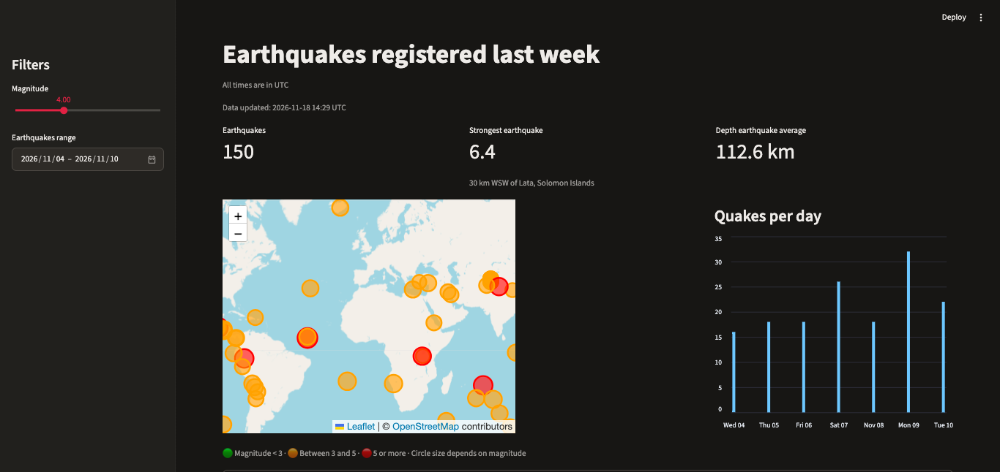

# Earthquake Map

Interactive dashboard of the last week's earthquakes, built with Python, pandas, Folium and Streamlit.

**Live demo:**  https://earthquake-project-9pkyixdbahzvattx4hw436.streamlit.app



## Features

- Interactive map with circles sized and colored by magnitude
- Filters by minimum magnitude and date range
- Summary metrics: number of events, strongest earthquake, average depth
- Daily earthquake count chart and summary table
- Data refreshed automatically from the USGS API (cached for 10 minutes)

## Tech stack

Python 3.12 · pandas · Folium · Streamlit · requests

## Run locally

```bash
git clone https://github.com/SebasWars/Earthquake-project.git
cd Earthquake-project
python3 -m venv .venv
source .venv/bin/activate
pip install -r requirements.txt
streamlit run app.py
```

## Project structure

```
app.py              # Streamlit dashboard
src/quakes/
├── config.py       # Paths
├── fetch.py        # Downloads data from the USGS API
├── loader.py       # JSON -> clean DataFrame
├── filters.py      # Magnitude and date filters
├── stats.py        # Aggregations
└── map_view.py     # DataFrame -> Folium map
data/               # Downloaded GeoJSON
```

Data logic is kept separate from presentation: the functions in `src/quakes` return values, and `app.py` decide how to display them.

## Data source

[USGS Earthquake Hazards Program](https://earthquake.usgs.gov/fdsnws/event/1/) - free, no API key required. Times are in UTC.
